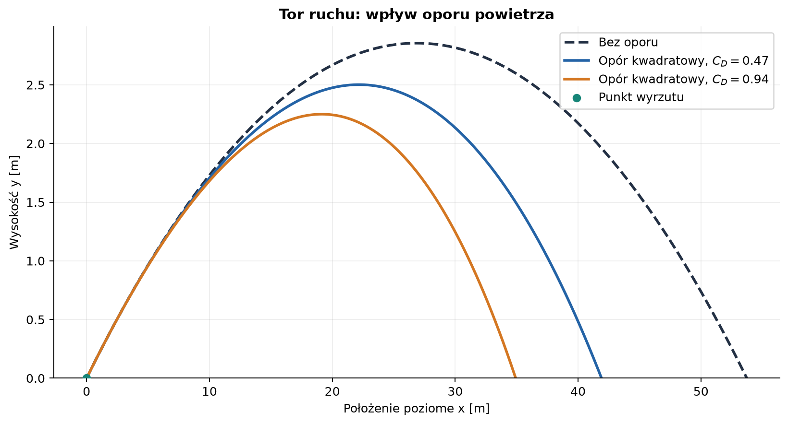
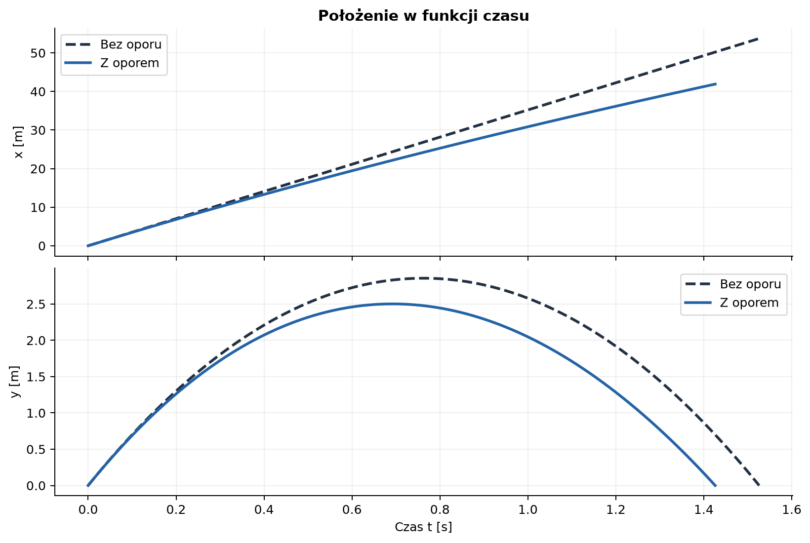
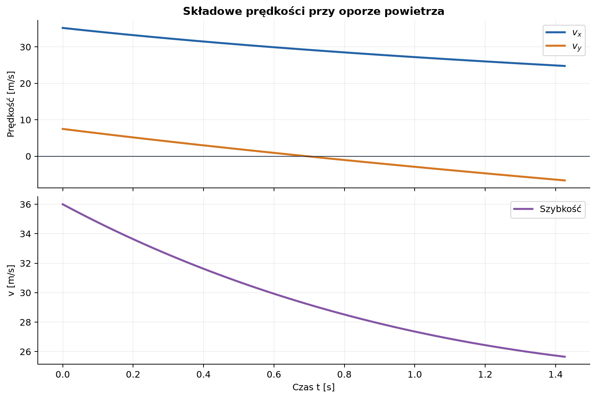
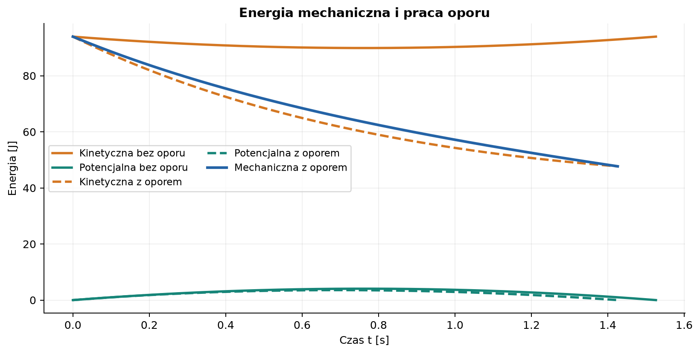
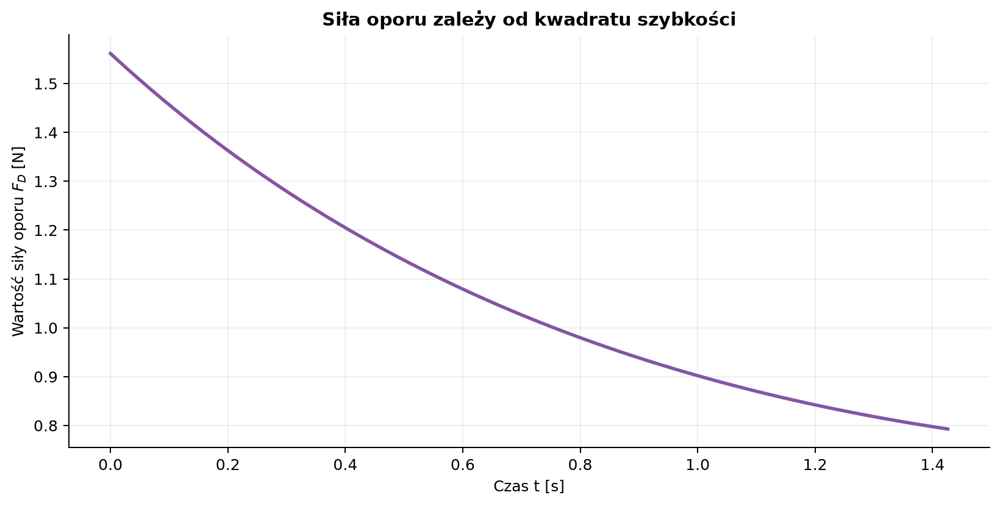

# Rzut ukośny — od modelu idealnego do oporu powietrza

*Raport obliczeniowy i przykład wykorzystania Markdown do prezentacji fizyki.*

**Temat:** ruch ciała wyrzuconego pod kątem do poziomu.  
**Metoda:** wyprowadzenie analityczne dla próżni, model siły oporu kwadratowego oraz całkowanie numeryczne metodą Rungego–Kutty czwartego rzędu.  
**Dane początkowe:** $v_0=36\,\mathrm{m/s}$, $\alpha=12^\circ=0{,}209440\,\mathrm{rad}$.  
**Charakter danych:** przykład modelowy; wykresy przedstawiają obliczenia, a nie pomiary.

Rzut ukośny jest ruchem jednocześnie poziomym i pionowym. Bez oporu składowe te są niezależne, a tor jest parabolą. W powietrzu siła oporu zależy od wektora prędkości, przez co składowe ruchu sprzęgają się, a tor przestaje być parabolą.

## Spis treści

1. [Cel, dane i założenia](#1-cel-dane-i-założenia)
2. [Rzut bez oporu powietrza](#2-rzut-bez-oporu-powietrza)
3. [Przykład liczbowy bez oporu](#3-przykład-liczbowy-bez-oporu)
4. [Rzut z oporem powietrza](#4-rzut-z-oporem-powietrza)
5. [Wyniki i porównanie modeli](#5-wyniki-i-porównanie-modeli)
6. [Wykresy i ich interpretacja](#6-wykresy-i-ich-interpretacja)
7. [Kod i odtwarzanie wyników](#7-kod-i-odtwarzanie-wyników)
8. [Ograniczenia modelu](#8-ograniczenia-modelu)
9. [Wnioski](#9-wnioski)

---

## 1. Cel, dane i założenia

Celem jest wyznaczenie toru, czasu lotu, maksymalnej wysokości oraz zasięgu dla dwóch modeli: idealnego rzutu bez oporu i rzutu z oporem powietrza. Porównanie pozwala zobaczyć, kiedy proste wzory na parabolę przestają wystarczać.

### 1.1. Dane i przyjęte założenia

Zgodnie z danymi indeksowymi przyjmuję:

$$
v_0=36\,\mathrm{m/s},
\qquad
\alpha=12^\circ
=12\frac{\pi}{180}\,\mathrm{rad}
\approx0{,}209440\,\mathrm{rad}.
$$

Stopień podaję dla czytelności wartości indeksowej; w obliczeniach numerycznych i wzorach trygonometrycznych kąt jest przeliczany na radiany, czyli jednostkę SI kąta płaskiego.

Początek układu współrzędnych znajduje się w punkcie wyrzutu. Oś $x$ jest pozioma i skierowana zgodnie z ruchem, a oś $y$ pionowa i skierowana w górę. Przyjmuję przyspieszenie ziemskie
$g=9{,}81\,\mathrm{m/s^2}$ oraz jednakowy poziom wyrzutu i lądowania.

Model z oporem opisuje kulę o masie $m=0{,}145\,\mathrm{kg}$ i promieniu $r=0{,}0365\,\mathrm{m}$ (wartości reprezentatywne dla piłki baseballowej). Dodatkowo przyjmuję gęstość powietrza
$\rho=1{,}225\,\mathrm{kg/m^3}$ i stały współczynnik oporu
$C_D=0{,}47$.

| Symbol | Znaczenie | Wartość lub jednostka SI |
| :--- | :--- | :---: |
| $v_0$ | szybkość początkowa | $36\,\mathrm{m/s}$ |
| $\alpha$ | kąt wyrzutu | $0{,}209440\,\mathrm{rad}$ ($12^\circ$) |
| $g$ | przyspieszenie grawitacyjne | $9{,}81\,\mathrm{m/s^2}$ |
| $m$ | masa kuli w modelu oporu | $0{,}145\,\mathrm{kg}$ |
| $r$ | promień kuli | $0{,}0365\,\mathrm{m}$ |
| $A=\pi r^2$ | pole przekroju czołowego | $0{,}00418539\,\mathrm{m^2}$ |
| $\rho$ | gęstość powietrza | $1{,}225\,\mathrm{kg/m^3}$ |
| $C_D$ | współczynnik oporu aerodynamicznego | $0{,}47$ (bezwymiarowy) |
| $\Delta t$ | krok całkowania numerycznego | $0{,}001\,\mathrm{s}$ |

W modelu nie uwzględniam wiatru ani zmiany gęstości powietrza z wysokością. Kula jest traktowana jak punkt materialny, a jej obrót i siła Magnusa są pominięte.

## 2. Rzut bez oporu powietrza

### 2.1. Rozkład prędkości początkowej

Prędkość początkową rozkładamy na składowe:

$$
v_{0x}=v_0\cos\alpha,
\qquad
v_{0y}=v_0\sin\alpha.
$$

Na ciało działa wyłącznie ciężar $\vec F_g=(0,-mg)$. Z drugiej zasady Newtona, $m\vec a=\vec F$, otrzymujemy:

$$
a_x=0,
\qquad
a_y=-g.
$$

### 2.2. Położenie i prędkość jako funkcje czasu

Całkując przyspieszenie po czasie i stosując warunki początkowe
$v_x(0)=v_{0x}$ oraz $v_y(0)=v_{0y}$:

$$
v_x(t)=v_0\cos\alpha,
\qquad
v_y(t)=v_0\sin\alpha-gt.
$$

Ponieważ składowe prędkości są pochodnymi położenia, całkowanie po raz drugi daje:

$$
x(t)=v_0\cos\alpha\,t,
\qquad
y(t)=v_0\sin\alpha\,t-\frac{1}{2}gt^2.
$$

W poziomie ruch jest jednostajny, a w pionie jednostajnie przyspieszony. Eliminując czas z równań (dla $\cos\alpha\ne0$, $t=x/(v_0\cos\alpha)$), otrzymujemy równanie toru:

$$
y(x)=x\tan\alpha-\frac{g\,x^2}{2v_0^2\cos^2\alpha}.
$$

Jest to parabola skierowana ramionami w dół.

### 2.3. Czas wznoszenia, wysokość i zasięg

W najwyższym punkcie składowa pionowa prędkości znika:

$$
v_y(t_{\mathrm{wzn}})=0
\quad\Longrightarrow\quad
t_{\mathrm{wzn}}=\frac{v_0\sin\alpha}{g}.
$$

Podstawiając ten czas do $y(t)$, uzyskujemy maksymalną wysokość:

$$
H=y(t_{\mathrm{wzn}})
=\frac{v_0^2\sin^2\alpha}{2g}.
$$

Przy powrocie na wysokość wyrzutu rozwiązanie $y(t)=0$ ma pierwiastki
$t=0$ oraz $t=2v_0\sin\alpha/g$. Pomijając chwilę startu:

$$
T=\frac{2v_0\sin\alpha}{g}.
$$

Zasięg poziomy jest położeniem w chwili lądowania:

$$
R=x(T)
=\frac{v_0^2\sin(2\alpha)}{g}.
$$

Wzór na zasięg wynika z tożsamości $2\sin\alpha\cos\alpha=\sin(2\alpha)$.
Dla ustalonej prędkości początkowej i jednakowej wysokości startu oraz lądowania funkcja $\sin(2\alpha)$ osiąga maksimum przy
$\alpha=\pi/4=45^\circ$. Wynik ten dotyczy wyłącznie modelu bez oporu.

**Kontrola jednostek:** $v_0t$ ma jednostkę $\mathrm{m}$, a $gt^2$ również ma jednostkę $\mathrm{m}$; wzory na $H$ i $R$ mają wymiar $v_0^2/g=\mathrm{m}$.

## 3. Przykład liczbowy bez oporu

Dla $\alpha=0{,}209440\,\mathrm{rad}$:

$$
v_{0x}=36\cos(0{,}209440)
\approx35{,}2133\,\mathrm{m/s},
$$

$$
v_{0y}=36\sin(0{,}209440)
\approx7{,}48482\,\mathrm{m/s}.
$$

Podstawienie do wyprowadzonych zależności daje:

| Wielkość | Wynik bez oporu | Jednostka SI |
| :--- | ---: | :---: |
| Składowa początkowa $v_{0x}$ | $35{,}2133$ | $\mathrm{m/s}$ |
| Składowa początkowa $v_{0y}$ | $7{,}48482$ | $\mathrm{m/s}$ |
| Czas do wierzchołka toru $t_{\mathrm{wzn}}$ | $0{,}762979$ | $\mathrm{s}$ |
| Maksymalna wysokość $H$ | $2{,}85538$ | $\mathrm{m}$ |
| Czas lotu $T$ | $1{,}52596$ | $\mathrm{s}$ |
| Zasięg $R$ | $53{,}7340$ | $\mathrm{m}$ |
| Szybkość w najwyższym punkcie | $35{,}2133$ | $\mathrm{m/s}$ |

W najwyższym punkcie prędkość nie jest zerowa: zanika tylko $v_y$. Składowa pozioma pozostaje stała i równa $v_{0x}$.



*Rysunek 1. Tor w próżni jest parabolą. Opór skraca zasięg i wysokość; zwiększenie $C_D$ dodatkowo wzmacnia ten efekt. Wariant $C_D=0{,}94$ jest analizą wrażliwości, a nie drugim pomiarem piłki.*

## 4. Rzut z oporem powietrza

### 4.1. Kwadratowe prawo oporu

Przy większych szybkościach często modeluje się opór aerodynamiczny siłą przeciwnie skierowaną do wektora prędkości, o wartości proporcjonalnej do kwadratu szybkości:

$$
\vec F_D=-\frac{1}{2}\rho C_D A\,|\vec v|\,\vec v,
\qquad
|\vec v|=\sqrt{v_x^2+v_y^2}.
$$

Współczynnik $C_D$ jest bezwymiarowy, a $A=\pi r^2$ jest polem przekroju czołowego kuli. Zapis wektorowy zapewnia, że opór zawsze działa przeciwnie do aktualnego ruchu, zarówno podczas wznoszenia, jak i opadania.

Wygodnie wprowadzić parametr:

$$
\lambda=\frac{\rho C_D A}{2m}.
$$

Ma on jednostkę $\mathrm{m^{-1}}$. Dla przyjętych danych
$\lambda=0{,}00830944\,\mathrm{m^{-1}}$.

### 4.2. Równania ruchu

Z drugiej zasady Newtona w kierunkach poziomym i pionowym:

$$
m\ddot{x}=-\frac{1}{2}\rho C_D A\,|\vec v|\,v_x,
$$

$$
m\ddot{y}=-mg-\frac{1}{2}\rho C_D A\,|\vec v|\,v_y.
$$

Po podzieleniu przez masę i zapisaniu jako układu równań pierwszego rzędu:

$$
\begin{aligned}
\dot{x}&=v_x, &\dot{y}&=v_y,\\
\dot{v}_x&=-\lambda\sqrt{v_x^2+v_y^2}\,v_x,
&\dot{v}_y&=-g-\lambda\sqrt{v_x^2+v_y^2}\,v_y.
\end{aligned}
$$

Warunki początkowe są takie same jak wcześniej:

$$
x(0)=y(0)=0,\qquad
v_x(0)=v_0\cos\alpha,\qquad
v_y(0)=v_0\sin\alpha.
$$

Ponieważ przyspieszenie zależy od obu składowych prędkości, równania nie rozdzielają się już na niezależny ruch poziomy i pionowy. W ogólności nie otrzymujemy paraboli ani prostych wzorów na czas lotu i zasięg. Rozwiązanie wyznaczamy numerycznie, aż ciało ponownie osiągnie $y=0$.

### 4.3. Sens fizyczny oporu i energii

Podczas pionowego spadania prędkość graniczna wynika z równowagi ciężaru i oporu. Dla prędkości skierowanej w dół o wartości $v_{\mathrm{gr}}$:

$$
mg=\frac{1}{2}\rho C_D A\,v_{\mathrm{gr}}^2,
\qquad
v_{\mathrm{gr}}=\sqrt{\frac{2mg}{\rho C_D A}}.
$$

Jest to wartość graniczna dla ustalonego pionowego spadania, a nie prędkość osiągana w tym krótkim rzucie.

Energia mechaniczna kuli względem poziomu gruntu to
$E=\tfrac12m|\vec v|^2+mgy$. Moc siły oporu jest ujemna:

$$
\frac{dE}{dt}
=\vec F_D\cdot\vec v
=-\frac{1}{2}\rho C_D A\,|\vec v|^3\leq0.
$$

W próżni energia mechaniczna pozostaje stała. W powietrzu jej część przechodzi w energię wewnętrzną otoczenia.

### 4.4. Całkowanie metodą Rungego–Kutty

Układ zapisujemy jako $\dot{\mathbf{s}}=\mathbf{f}(t,\mathbf{s})$, gdzie
$\mathbf{s}=(x,y,v_x,v_y)$. Metoda RK4 wyznacza stan po kroku $h$ jako:

$$
\begin{aligned}
\mathbf{k}_1&=\mathbf{f}(t,\mathbf{s}),\\
\mathbf{k}_2&=\mathbf{f}(t+\tfrac h2,\mathbf{s}+\tfrac h2\mathbf{k}_1),\\
\mathbf{k}_3&=\mathbf{f}(t+\tfrac h2,\mathbf{s}+\tfrac h2\mathbf{k}_2),\\
\mathbf{k}_4&=\mathbf{f}(t+h,\mathbf{s}+h\mathbf{k}_3),\\
\mathbf{s}(t+h)&=\mathbf{s}(t)+\tfrac h6
(\mathbf{k}_1+2\mathbf{k}_2+2\mathbf{k}_3+\mathbf{k}_4).
\end{aligned}
$$

W skrypcie używam kroku $h=0{,}001\,\mathrm{s}$. Po wykryciu przejścia przez poziom gruntu w ostatnim kroku stan lądowania jest interpolowany liniowo między dwoma sąsiednimi stanami. Jest to wystarczająca rozdzielczość dla prezentowanych wykresów; sprawdzenie z krokiem dwukrotnie mniejszym zmienia zasięg o mniej niż $0{,}001\,\mathrm{m}$.

## 5. Wyniki i porównanie modeli

W modelu z oporem obliczony wierzchołek toru występuje po około
$0{,}692\,\mathrm{s}$. Zestawienie wyników:

| Wielkość | Bez oporu | Z oporem $C_D=0{,}47$ | Jednostka SI |
| :--- | ---: | ---: | :---: |
| Czas do maksymalnej wysokości | $0{,}762979$ | $0{,}692$ | $\mathrm{s}$ |
| Maksymalna wysokość | $2{,}85538$ | $2{,}50157$ | $\mathrm{m}$ |
| Czas lotu | $1{,}52596$ | $1{,}42593$ | $\mathrm{s}$ |
| Zasięg | $53{,}7340$ | $41{,}9098$ | $\mathrm{m}$ |
| Szybkość przy lądowaniu | $36{,}0000$ | $25{,}6519$ | $\mathrm{m/s}$ |
| Energia mechaniczna utracona w locie | $0$ | $46{,}2534$ | $\mathrm{J}$ |

Względem próżni opór zmniejsza zasięg o około $22{,}0\%$, maksymalną wysokość o około $12{,}4\%$ i czas lotu o około $6{,}6\%$. Kula ląduje z szybkością mniejszą niż początkowa, ponieważ opór wykonuje ujemną pracę. W modelu bez oporu szybkość przy powrocie na tę samą wysokość jest równa szybkości początkowej.

Wartości dla $C_D=0{,}94$ to zasięg $34{,}9255\,\mathrm{m}$ i wysokość maksymalna $2{,}24991\,\mathrm{m}$. Ten wariant pokazuje zależność wyniku od siły oporu; pozostałe parametry są bez zmian.

## 6. Wykresy i ich interpretacja



*Rysunek 2. Bez oporu położenie poziome rośnie liniowo. Z oporem tempo wzrostu $x(t)$ maleje, ponieważ opór zmniejsza składową $v_x$. W obu modelach wysokość osiąga maksimum, a następnie maleje.*



*Rysunek 3. Opór zmienia obie składowe prędkości. W najwyższym punkcie $v_y=0$, ale szybkość nadal jest dodatnia, bo kula porusza się poziomo.*



*Rysunek 4. Bez oporu suma energii kinetycznej i potencjalnej jest stała. W przypadku oporu energia mechaniczna maleje; energia kinetyczna i potencjalna są przedstawione dla tego samego poziomu odniesienia $y=0$.*



*Rysunek 5. Dla oporu kwadratowego wartość siły rośnie jak $|\vec v|^2$. Jej zmiany w czasie wynikają ze zmian szybkości kuli.*

## 7. Kod i odtwarzanie wyników

Wykresy wygenerowano lokalnie w Pythonie za pomocą NumPy i Matplotlib. Pełny, uruchamialny skrypt znajduje się w pliku [generuj_wykresy.py](generuj_wykresy.py). Skrypt zapisuje pięć plików PNG w katalogu `files/rzut_ukosny/`. Nie wymaga SciPy ani Colaba.

Z katalogu `pages/solutions/04_sol_vscode` można zainstalować wymagane biblioteki i uruchomić obliczenia:

```bash
python -m pip install numpy matplotlib
python generuj_wykresy.py
```

Poniższy fragment pokazuje równania modelu oraz krok całkowania użyte w skrypcie:

```python
import numpy as np

g = 9.81
rho = 1.225
cd = 0.47
mass = 0.145
area = np.pi * 0.0365**2

def pochodna(stan):
    x, y, vx, vy = stan
    szybkosc = np.hypot(vx, vy)
    lam = rho * cd * area / (2 * mass)
    ax = -lam * szybkosc * vx
    ay = -g - lam * szybkosc * vy
    return np.array([vx, vy, ax, ay])

def krok_rk4(stan, dt):
    k1 = pochodna(stan)
    k2 = pochodna(stan + dt * k1 / 2)
    k3 = pochodna(stan + dt * k2 / 2)
    k4 = pochodna(stan + dt * k3)
    return stan + dt * (k1 + 2*k2 + 2*k3 + k4) / 6

v0 = 36.0
alpha = np.deg2rad(12.0)
stan = np.array([
    0.0, 0.0, v0 * np.cos(alpha), v0 * np.sin(alpha)
])
```

Poniższy skrócony fragment pokazuje, jak z wyników całkowania tworzy się wykres toru. Pełny skrypt zawiera również obliczenia dla próżni i $C_D=0{,}94$, obsługę lądowania oraz pozostałe cztery wykresy.

```python
import matplotlib.pyplot as plt

fig, ax = plt.subplots()
ax.plot(x_bez_oporu, y_bez_oporu, "--", label="Bez oporu")
ax.plot(x_z_oporem, y_z_oporem, label="Z oporem")
ax.set_xlabel("Położenie poziome x [m]")
ax.set_ylabel("Wysokość y [m]")
ax.set_ylim(bottom=0)
ax.grid(True)
ax.legend()
fig.savefig("files/rzut_ukosny/tory_ruchu.png", dpi=180)
```

## 8. Ograniczenia modelu

- **Stałe $C_D$:** rzeczywisty współczynnik oporu może zależeć od liczby Reynoldsa, orientacji i prędkości.
- **Brak wiatru:** powietrze uznano za nieruchome. Przy wietrze opór zależałby od prędkości względem powietrza, nie względem gruntu.
- **Brak obrotu:** rotująca piłka może doznawać siły Magnusa, której tu nie modeluję.
- **Stała gęstość:** $\rho$ jest stałe na całej wysokości toru.
- **Punkt materialny:** rozmiar i deformacja kuli nie są uwzględnione.
- **Równy poziom startu i lądowania:** zmiana wysokości końcowej zmienia czas lotu i zasięg.

Wyniki dla oporu są więc spójnym przykładem obliczeniowym, a nie dokładną prognozą lotu konkretnej piłki w dowolnych warunkach.

## 9. Wnioski

1. Bez oporu ruch rozdziela się na składową poziomą o stałej prędkości i pionową z przyspieszeniem $-g$; tor jest parabolą.
2. Dla $v_0=36\,\mathrm{m/s}$ i $\alpha=12^\circ$ model idealny daje zasięg $53{,}7340\,\mathrm{m}$ i wysokość maksymalną $2{,}85538\,\mathrm{m}$.
3. Opór kwadratowy sprzęga składowe ruchu i wymaga rozwiązania numerycznego. Przy przyjętych parametrach zasięg wynosi $41{,}9098\,\mathrm{m}$.
4. Opór zmniejsza szybkość i energię mechaniczną; nie można zakładać, że prędkość przy lądowaniu będzie równa początkowej.
5. Wielkość wpływu oporu zależy od masy, geometrii, gęstości powietrza i współczynnika $C_D$, dlatego te parametry należy podawać razem z wynikiem.